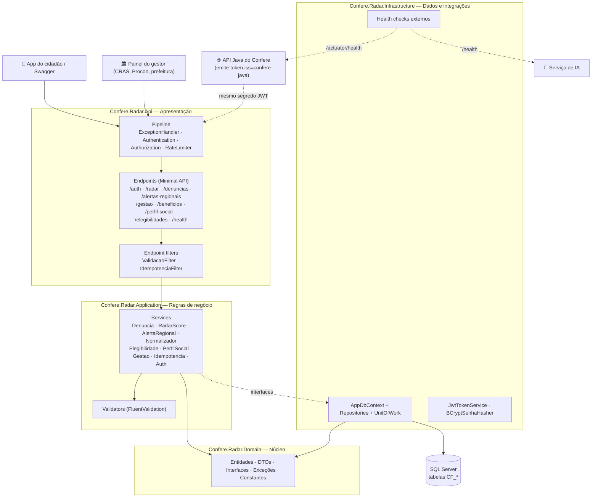
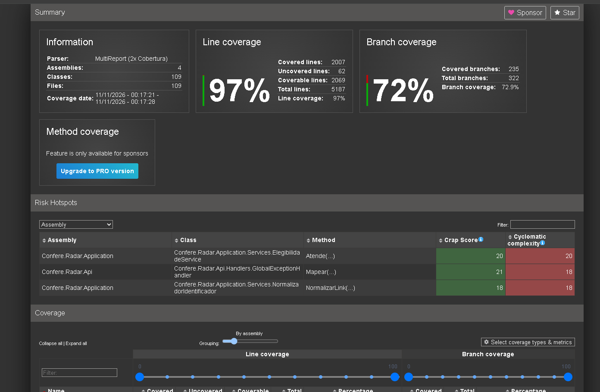
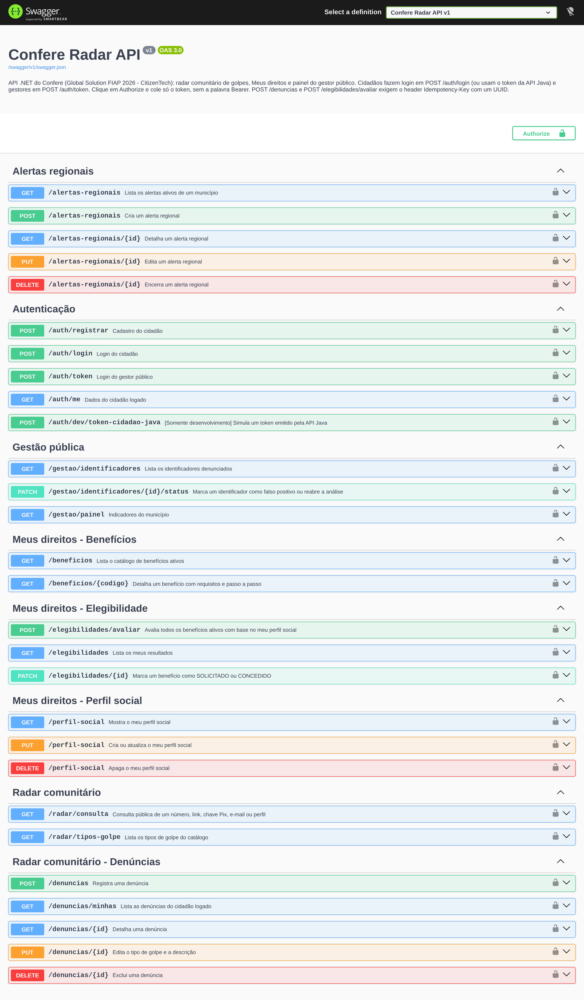
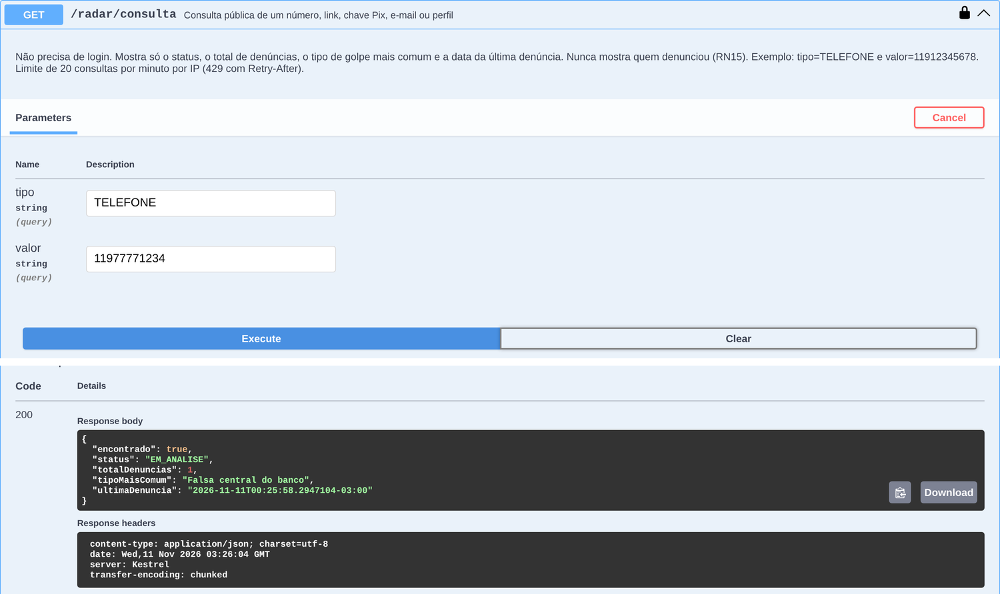
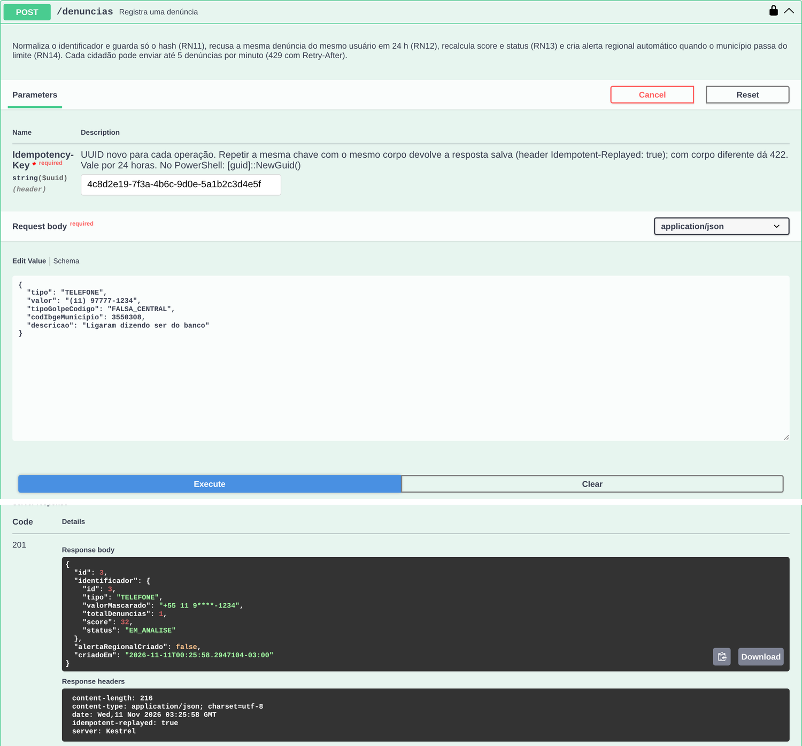
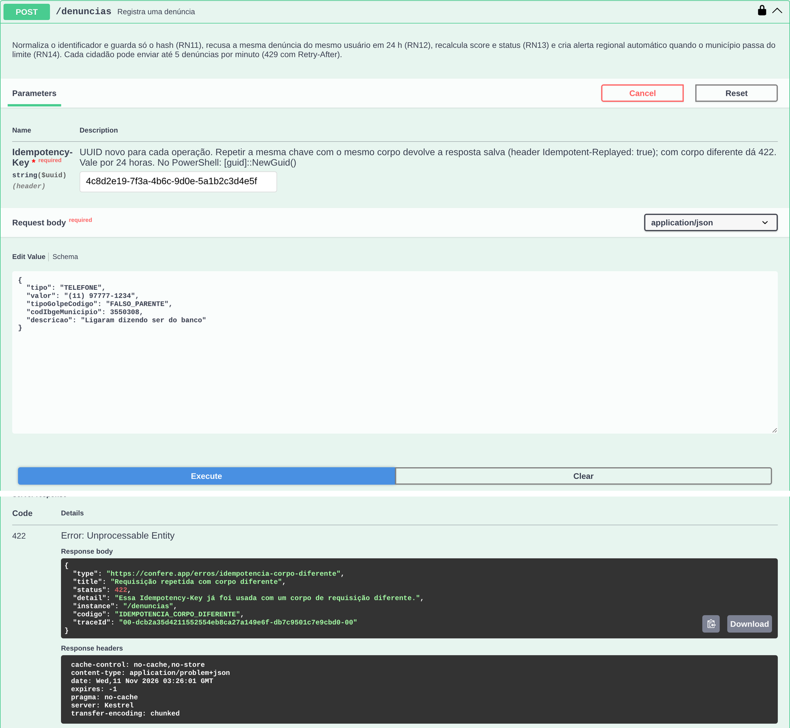
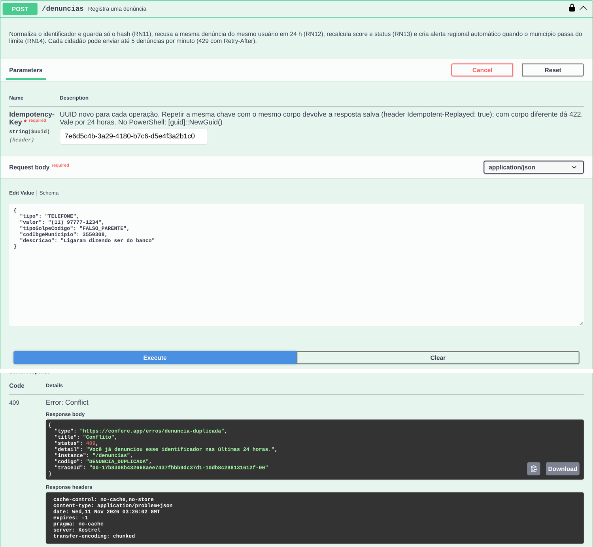
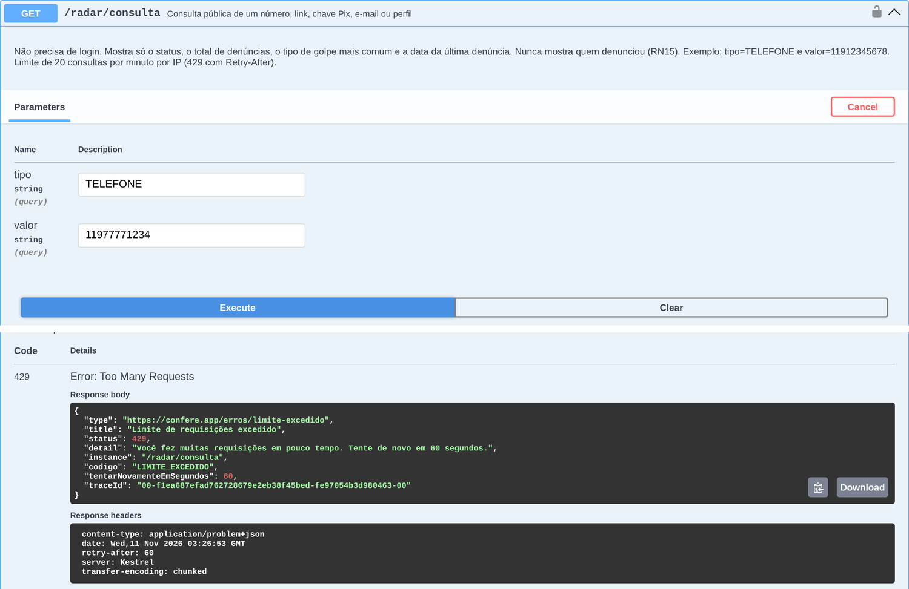
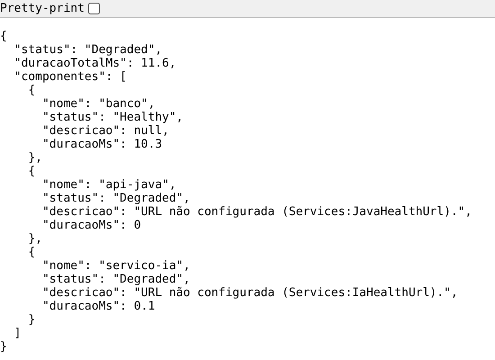
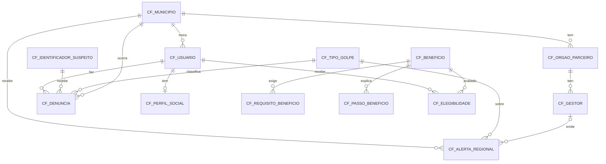

# Confere — API .NET (Radar)

API .NET do **Confere**, a solução do nosso grupo para a **Global Solution 2026/2 da FIAP**, tema **CitizenTech**.

O Confere ataca dois problemas que andam juntos na vida de muita gente, principalmente idosos e famílias de baixa renda:

1. **Golpes digitais.** É a ligação da "falsa central do banco", a selfie pedida para a "prova de vida do INSS", o link de "taxa de entrega dos Correios". Quem recebe não tem como saber se aquele número ou link já enganou outras pessoas.
2. **Direitos não acessados.** Muita gente tem direito à Tarifa Social de Energia, ao BPC ou ao abono salarial e nunca pediu, porque não sabe que tem direito ou não entende o passo a passo.

Esta API é a parte .NET do Confere e cuida de três frentes:

- **Radar comunitário.** O cidadão denuncia um telefone, link, chave Pix, e-mail ou perfil. Qualquer pessoa, sem login, consegue consultar se aquele identificador já foi denunciado. Quando vários golpes do mesmo tipo são confirmados numa cidade, a API cria um **alerta regional automático**.
- **Meus direitos.** O cidadão preenche um perfil social (só com consentimento e com a renda em faixas) e a API avalia em quais benefícios ele **provavelmente** tem direito, explicando o porquê em linguagem simples.
- **Painel do gestor público.** Gestores de CRAS, Procon e prefeitura entram com login próprio, emitem alertas para o seu município, descartam números denunciados por engano e acompanham os indicadores da cidade.

A API Java do grupo cuida da verificação de mensagens com IA e do app do cidadão. As duas APIs são **independentes**, mas aceitam o **mesmo login** (explicado em [Autenticação](#autenticação-e-autorização-jwt)).

## Quem fez

Sou o Murillo, da turma **2TDSPW** (2º ano de ADS na FIAP). No grupo eu fiquei responsável pela API .NET. Os integrantes são:

- Murillo Fernandes Carapia, RM: 564969
- João Vitor Lacerda, RM: 565565
- Kauan Vieira de Lima, RM: 565403
- Pedro de Matos Previtali, RM: 564184

## Onde está cada requisito da disciplina

| Requisito | Pontos | Onde está no projeto |
|---|---|---|
| Minimal API RESTful com validações, códigos HTTP e OpenAPI/Swagger | 20 | `Confere.Radar.Api/Endpoints` (MapGroup por domínio, `TypedResults`), validação com FluentValidation em `Filters/ValidacaoFilter.cs`, erros no padrão ProblemDetails em `Handlers/GlobalExceptionHandler.cs`, Swagger em `Extensions/SwaggerExtensions.cs` |
| Autenticação e autorização com JWT | 20 | `Extensions/AuthenticationExtensions.cs` (dois emissores, políticas `Cidadao`, `Gestor` e `CidadaoOuGestor`) e `Infrastructure/Security/JwtTokenService.cs` |
| Idempotência | 15 | `Filters/IdempotenciaFilter.cs` + `Application/Services/IdempotenciaService.cs`, tabela `CF_IDEMPOTENCIA` |
| Rate limiting com 429 | 15 | `Extensions/RateLimitingExtensions.cs` e a pasta `RateLimiting/` (limites configuráveis no `appsettings.json`) |
| Testes unitários e de integração com xUnit | 20 | `Confere.Radar.UnitTests` (167 testes) e `Confere.Radar.IntegrationTests` (52 testes), com 97% de cobertura de linhas |
| Health checks da API, do banco e de serviços externos | 10 | `Extensions/HealthCheckExtensions.cs` e `Infrastructure/HealthChecks/ServicoExternoHealthCheck.cs` (`/health/live` e `/health/ready`) |

## Tecnologias

| Tecnologia | Pra que serve |
|---|---|
| **.NET 10** + ASP.NET Core **Minimal APIs** | A API em si |
| **Entity Framework Core 10** + **SQL Server 2022** | Banco de dados, com Code-First e migrations |
| **Docker** | Sobe o SQL Server local com um comando |
| **FluentValidation** | Validação dos dados de entrada |
| **JWT Bearer** + **BCrypt** | Login e controle de acesso, com as senhas guardadas só como hash |
| **Swashbuckle (Swagger/OpenAPI)** | Documentação e teste dos endpoints |
| **Rate Limiter** nativo do ASP.NET Core | Limite de requisições |
| **Health Checks** nativos | Monitoramento da API, do banco e da API Java e do serviço de IA |
| **xUnit**, **Moq**, **WebApplicationFactory**, **EF Core InMemory**, **Coverlet** | Testes e cobertura |

---

# Arquitetura

O projeto segue a **Clean Architecture**, com a mesma organização que usei na Sprint 4. As dependências sempre apontam de fora pra dentro: o Domain não conhece banco nem HTTP, e é isso que permite testar todas as regras de negócio sem banco nenhum.

## Diagrama da solução



## Cada camada

| Projeto | Responsabilidade |
|---|---|
| `Confere.Radar.Domain` | Entidades, DTOs (records), interfaces dos repositórios e services, exceções de negócio e constantes (status, tipos, códigos de erro). Não depende de nenhum outro projeto. |
| `Confere.Radar.Application` | As regras de negócio (RN11 a RN18) nos services, mais os validators. Depende só do Domain. |
| `Confere.Radar.Infrastructure` | EF Core (DbContext, configurações Fluent API, seed, migrations), repositórios, JWT, BCrypt e health checks externos. |
| `Confere.Radar.Api` | Endpoints, filtros, autenticação, rate limiting, Swagger e o tratamento global de erros. |
| `Confere.Radar.UnitTests` | Testes unitários dos services e validators, com Moq. |
| `Confere.Radar.IntegrationTests` | Testes de ponta a ponta com WebApplicationFactory, banco em memória e tokens JWT de teste. |

---

# Como instalar e executar

> ⚠️ A API usa **Code-First com EF Core Migrations**, então você não precisa criar nenhuma tabela na mão. O EF cria tudo, inclusive os dados iniciais (municípios, tipos de golpe, benefícios e usuários de teste).

## Pré-requisitos

1. **.NET 10 SDK**: https://dotnet.microsoft.com/download
2. **Docker Desktop**: https://www.docker.com/products/docker-desktop (pra subir o SQL Server)

Pra conferir:

```powershell
dotnet --version
docker --version
```

O primeiro tem que mostrar algo como `10.0.x`.

## Passo 1 — Clonar o repositório

```powershell
git clone https://github.com/MurilloFernandesCarapia/Confere-GS.git
cd Confere-GS
```

## Passo 2 — Subir o SQL Server com Docker

A senha do SQL Server fica num arquivo `.env`, que **não vai pro GitHub**. Cria o seu a partir do exemplo e troca a senha:

```powershell
copy .env.example .env
notepad .env
```

> A senha do SQL Server precisa ter pelo menos 8 caracteres, com letra maiúscula, minúscula, número e símbolo.

Com o Docker Desktop aberto:

```powershell
docker compose up -d
```

Isso sobe o container `confere-sqlserver` na porta `1433`. Pra conferir, roda `docker ps`: ele tem que aparecer como `Up`.

## Passo 3 — Instalar a ferramenta do EF Core (uma vez só)

```powershell
dotnet tool install --global dotnet-ef
```

Se já estiver instalada, ele avisa e está tudo certo. Feche e abra o PowerShell de novo depois disso.

## Passo 4 — Configurar a conexão e a chave do JWT

Nenhuma credencial fica no `appsettings.json`: o arquivo versionado tem os campos vazios de propósito. A connection string e a chave do JWT ficam no **User Secrets**, fora da pasta do projeto:

```powershell
cd Confere.Radar.Api
dotnet user-secrets set "ConnectionStrings:Default" "Server=localhost,1433;Database=ConfereRadar;User Id=sa;Password=A_SENHA_DO_SEU_.ENV;TrustServerCertificate=True"
dotnet user-secrets set "Jwt:Secret" "uma-chave-longa-e-secreta-com-pelo-menos-32-caracteres"
cd ..
```

- Em `Password`, coloque a mesma senha que você colocou no `.env`.
- Em `Jwt:Secret`, coloque a **mesma chave da API Java**, pra que as duas APIs aceitem o mesmo login. Essa chave é combinada entre o grupo em particular e nunca vai pro GitHub.

> Se a chave tiver menos de 32 caracteres, a API nem sobe e avisa o motivo no console. Isso é de propósito.

## Passo 5 — Criar as tabelas (aplicar as migrations)

```powershell
dotnet ef database update --project Confere.Radar.Infrastructure --startup-project Confere.Radar.Api
```

Isso cria o banco `ConfereRadar` com as 14 tabelas `CF_*` (chaves estrangeiras, índices e check constraints) e os dados iniciais.

## Passo 6 — Rodar a API

```powershell
dotnet run --project Confere.Radar.Api
```

O Swagger abre sozinho, ou é só acessar:

- **HTTP:** http://localhost:5080/swagger
- **HTTPS:** https://localhost:7080/swagger

## Usuários de teste (já vêm no banco)

| Perfil | E-mail | Senha | Login em |
|---|---|---|---|
| Cidadão | `cida@confere.app` | `Senha@123` | `POST /auth/login` |
| Gestor (CRAS Centro — São Paulo) | `gestor@cras.sp.gov.br` | `Senha@123` | `POST /auth/token` |

> 🔐 Esses usuários existem só pra demonstração. As senhas ficam no banco apenas como hash BCrypt.

---

# Autenticação e autorização (JWT)

## Um login para as duas APIs

A API .NET é **independente** da API Java: ela tem o próprio cadastro (`POST /auth/registrar`) e o próprio login (`POST /auth/login`), e funciona mesmo com a API Java fora do ar. Mesmo assim, as duas usam a **mesma chave** e a **mesma audience** (`confere-app`), então:

- O token emitido aqui tem `iss = confere-radar`.
- O token emitido pela API Java tem `iss = confere-java`, e **também é aceito aqui**.
- Na primeira vez que alguém chega com um token da API Java, a API .NET procura o cidadão **pelo e-mail**. Se ele ainda não existe, é criado aqui na hora (origem `JAVA`). Se essa pessoa depois fizer o cadastro aqui com o mesmo e-mail, o cadastro só define a senha dela.

Em ambiente de desenvolvimento existe o `POST /auth/dev/token-cidadao-java`, que gera um token igual ao da API Java pra demonstrar essa integração. Ele **não existe fora de Development**, e há um teste de integração que garante isso.

## Quem pode o quê

| Ação | Sem token | Cidadão | Gestor |
|---|---|---|---|
| Consultar o radar e ver os tipos de golpe | ✅ | ✅ | ✅ |
| Denunciar, editar e excluir as próprias denúncias | ❌ 401 | ✅ | ❌ 403 |
| Ver e editar a denúncia de outra pessoa | ❌ 401 | ❌ 403 | ❌ 403 |
| Ver alertas regionais | ❌ 401 | ✅ | ✅ |
| Criar, editar e encerrar alertas | ❌ 401 | ❌ 403 | ✅ (só no município do órgão) |
| Gestão: identificadores e painel | ❌ 401 | ❌ 403 | ✅ (painel só do município do órgão) |
| Benefícios, perfil social e elegibilidade | ❌ 401 | ✅ | ❌ 403 |

## Como fazer login no Swagger

1. Abra `POST /auth/login` (cidadão) ou `POST /auth/token` (gestor), clique em **Try it out** e mande o e-mail e a senha.
2. Copie o valor de `token` da resposta.
3. Clique em **Authorize** (cadeado no topo), cole **só o token**, sem a palavra `Bearer`, e confirme.

O token vale 8 horas. Quando ele vence, a API responde 401 com a mensagem "O token expirou. Faça login novamente.".

---

# Regras de negócio

Os códigos (RN11, RN12, …) são os mesmos da especificação do grupo e aparecem no código e no nome dos testes.

| Regra | O que faz | Onde está |
|---|---|---|
| **RN11** Normalização e hash | Telefone vira só dígitos com DDI 55; link perde `http(s)://`, `www.`, parâmetros `utm_*` e o `#`; e-mail, chave Pix e perfil ficam em minúsculas e sem espaços. O banco guarda **só o hash SHA-256** e um valor mascarado (`+55 11 9****-5678`). Por isso `(11) 91234-5678` e `11912345678` são o mesmo número. | `NormalizadorIdentificador` |
| **RN12** Denúncia duplicada | A mesma pessoa não pode denunciar o mesmo identificador de novo em 24 h: **409** `DENUNCIA_DUPLICADA`. | `DenunciaService` |
| **RN13** Score e status | `score = mín(100, total × 12 + 20 se a última denúncia tem menos de 48 h + 10 × (municípios − 1))`. Com 5 denúncias e score ≥ 70 vira **CONFIRMADO**. Um número confirmado não volta pra análise só porque o bônus de 48 h venceu; volta só se denúncias forem excluídas e o total cair abaixo de 5. O que o gestor marca como **DESCARTADO** não volta a confirmado sozinho. | `RadarScoreService` |
| **RN14** Alerta regional automático | Quando um município tem 3 ou mais identificadores CONFIRMADOS do mesmo tipo de golpe nas últimas 48 h e não há alerta ativo igual, a API cria um alerta `AUTOMATICO`, nível `ATENCAO`, válido por 7 dias. | `AlertaRegionalService` |
| **RN15** Privacidade do radar | A consulta pública devolve só status, total, tipo de golpe mais comum e data da última denúncia. **Nunca** mostra quem denunciou. | `RadarService` |
| **RN16** Elegibilidade | Requisitos do mesmo grupo valem juntos (E) e grupos diferentes são alternativas (OU). Algum grupo atendido dá **PROVAVEL**; dado faltante ou benefício sem requisito dá **POSSIVEL**; nenhum grupo atendido dá **INELEGIVEL**. Cada resultado vem com o motivo em linguagem simples. O que o cidadão marcou como SOLICITADO ou CONCEDIDO nunca é sobrescrito. | `ElegibilidadeService` |
| **RN17** Consentimento | O perfil social só é gravado com `consentimento: true` (sem isso a resposta é **403** `CONSENTIMENTO_PENDENTE`). A renda entra só por faixa (`ATE_1_4`, `ATE_1_2`, `ATE_1`, `ATE_2`, `ACIMA_2`), nunca o valor exato. Excluir o perfil apaga também os resultados calculados a partir dele. | `PerfilSocialService` |
| **RN18** Idempotência e limites | Ver as duas seções abaixo. | `IdempotenciaFilter` e `RateLimitingExtensions` |

---

# Idempotência

`POST /denuncias` e `POST /elegibilidades/avaliar` exigem o header **`Idempotency-Key`** com um UUID. Isso evita, por exemplo, que um idoso com internet ruim aperte "denunciar" três vezes e conte três denúncias.

| Situação | Resposta |
|---|---|
| Sem o header, ou o valor não é um UUID | **400** |
| Chave nova | Grava `PROCESSANDO` em `CF_IDEMPOTENCIA`, executa a operação e salva o status e o corpo da resposta como `CONCLUIDA` |
| Mesma chave e mesmo corpo | Devolve a **resposta salva**, com o header **`Idempotent-Replayed: true`**, sem executar de novo |
| Mesma chave com corpo diferente (ou de outro usuário) | **422** `IDEMPOTENCIA_CORPO_DIFERENTE` |
| Mesma chave ainda em processamento | **409** `IDEMPOTENCIA_EM_PROCESSAMENTO` |
| Chave com mais de 24 h | Expirou, então é tratada como nova |

- **Como o corpo é comparado:** pelo hash SHA-256 do DTO da requisição serializado em JSON. Espaços ou ordem diferente dos campos não contam como corpo diferente.
- **Quando a operação dá erro** (por exemplo 400 ou 409 de denúncia duplicada), a chave é liberada. Assim o cliente consegue tentar de novo com a mesma chave depois de corrigir o problema.

Pra gerar um UUID no PowerShell: `[guid]::NewGuid()`.

---

# Rate limiting

| Política | Onde | Regra | Por quem |
|---|---|---|---|
| `consulta-publica` | `GET /radar/consulta` | FixedWindow: 20 por minuto | IP |
| `denuncia` | `POST /denuncias` | TokenBucket: 5 fichas, repõe 5 por minuto | Usuário |
| Global | Todos os endpoints | SlidingWindow: 100 por minuto | Usuário logado, ou IP se anônimo |

- **Quando estoura:** a API responde **429** com o header `Retry-After` e um ProblemDetails com `codigo: "LIMITE_EXCEDIDO"` e `tentarNovamenteEmSegundos`.
- **Ficam fora do limite:** `/health` e `/swagger`, pra não derrubar o monitoramento.
- **Os limites mudam sem mexer no código**, pela seção `RateLimiting` do `appsettings.json`. Os testes de integração usam isso pra baixar os limites e provocar o 429 rapidinho.

---

# Health checks

| Endpoint | O que verifica |
|---|---|
| `GET /health/live` | Só se o processo da API está de pé (`self`) |
| `GET /health/ready` | O **banco** (`AddDbContextCheck`), a **API Java** (`Services:JavaHealthUrl`, ex.: `/actuator/health`) e o **serviço de IA** (`Services:IaHealthUrl`, ex.: `/health`) |

A resposta é um JSON com o status geral, o tempo total e o status de cada componente. Se a API Java ou o serviço de IA estiverem fora do ar ou sem URL configurada, o status fica **Degraded** e não **Unhealthy**: o radar e os direitos continuam funcionando sem eles.

Pra apontar os serviços externos:

```powershell
cd Confere.Radar.Api
dotnet user-secrets set "Services:JavaHealthUrl" "http://localhost:8080/actuator/health"
dotnet user-secrets set "Services:IaHealthUrl" "http://localhost:8000/health"
```

---

# Padrão de erros

Todos os erros saem no formato **ProblemDetails** (RFC 9457), com dois campos a mais: `codigo` e, nos erros de validação, `erros` (a lista de campos com problema).

```json
{
  "type": "https://confere.app/erros/validacao",
  "title": "Dados inválidos",
  "status": 400,
  "detail": "Um ou mais campos estão inválidos.",
  "instance": "/denuncias",
  "codigo": "VALIDACAO",
  "erros": [
    { "campo": "tipo", "mensagem": "Tipo inválido. Use um destes: TELEFONE, LINK, CHAVE_PIX, EMAIL, PERFIL." }
  ]
}
```

| Status | `codigo` | Quando |
|---|---|---|
| 400 | `VALIDACAO` | Campo inválido, JSON mal formado, header de idempotência ausente |
| 401 | `NAO_AUTENTICADO` | Sem token, token inválido ou expirado, senha errada |
| 403 | `SEM_PERMISSAO` | Papel errado, recurso de outra pessoa, município de outro órgão |
| 403 | `CONSENTIMENTO_PENDENTE` | Perfil social sem consentimento |
| 404 | `NAO_ENCONTRADO` | Registro ou rota inexistente |
| 405 | `METODO_NAO_PERMITIDO` | Método HTTP que a rota não aceita |
| 409 | `DENUNCIA_DUPLICADA` / `CONFLITO` / `IDEMPOTENCIA_EM_PROCESSAMENTO` | Regras de conflito |
| 422 | `IDEMPOTENCIA_CORPO_DIFERENTE` | Mesma `Idempotency-Key` com outro corpo |
| 429 | `LIMITE_EXCEDIDO` | Limite de requisições |
| 500 | `ERRO_INTERNO` | Erro inesperado (o detalhe vai pro log, nunca pra resposta) |

As datas saem sempre no fuso de Brasília (`2026-11-18T14:32:00-03:00`) e os nomes dos campos em camelCase.

---

# Endpoints

| Método | Rota | O que faz | Acesso |
|---|---|---|---|
| POST | `/auth/registrar` | Cadastro do cidadão | público |
| POST | `/auth/login` | Login do cidadão | público |
| POST | `/auth/token` | Login do gestor | público |
| GET | `/auth/me` | Dados do cidadão logado | Cidadão |
| GET | `/radar/consulta?tipo=&valor=` | Consulta pública (RN15) | público · limite `consulta-publica` |
| GET | `/radar/tipos-golpe` | Catálogo de tipos de golpe | público |
| POST | `/denuncias` | Nova denúncia (RN11 a RN14) | Cidadão · idempotência · limite `denuncia` |
| GET | `/denuncias/minhas?pagina=&tamanho=` | Minhas denúncias (paginado) | Cidadão |
| GET · PUT · DELETE | `/denuncias/{id}` | Detalhe, edição e exclusão (só o dono) | Cidadão |
| GET | `/alertas-regionais?codIbge=` | Alertas ativos do município | Cidadão ou Gestor |
| GET | `/alertas-regionais/{id}` | Detalhe de um alerta | Cidadão ou Gestor |
| POST · PUT · DELETE | `/alertas-regionais` e `/{id}` | Criar, editar e encerrar alertas | Gestor |
| GET | `/gestao/identificadores?status=` | Identificadores denunciados | Gestor |
| PATCH | `/gestao/identificadores/{id}/status` | Marcar DESCARTADO ou reabrir | Gestor |
| GET | `/gestao/painel?codIbge=&de=&ate=` | Indicadores do município | Gestor |
| GET | `/beneficios` e `/beneficios/{codigo}` | Catálogo e detalhe com passo a passo | Cidadão |
| GET · PUT · DELETE | `/perfil-social` | Meu perfil social (RN17) | Cidadão |
| POST | `/elegibilidades/avaliar` | Avalia todos os benefícios (RN16) | Cidadão · idempotência |
| GET | `/elegibilidades` | Meus resultados | Cidadão |
| PATCH | `/elegibilidades/{id}` | Marcar SOLICITADO ou CONCEDIDO | Cidadão |
| GET | `/health/live` e `/health/ready` | Monitoramento | público |

A especificação OpenAPI completa foi exportada para [`docs/swagger.json`](docs/swagger.json). Dá pra importar no Postman ou no Insomnia sem rodar a API.

---

# Testes

## Como rodar

```powershell
dotnet test
```

Os testes **não precisam** do Docker nem do SQL Server: os de integração sobem a API inteira em memória, com banco InMemory e uma chave JWT só de teste.

Resultado: **219 testes, todos passando** (167 unitários + 52 de integração).

## Testes unitários (167)

| Classe | O que cobre |
|---|---|
| `NormalizadorIdentificadorTests` | RN11: formatos de telefone, link com `utm`/`www`/`#`, e-mail, Pix, perfil, máscaras e hash |
| `RadarScoreServiceTests` | RN13: a fórmula do score em vários cenários e a promoção a CONFIRMADO / DESCARTADO |
| `AlertaRegionalServiceTests` | RN14: o alerta automático e as permissões do gestor por município |
| `DenunciaServiceTests` | RN12: denúncia duplicada, dono da denúncia, edição e exclusão com recálculo |
| `ElegibilidadeServiceTests` | RN16: **todos os benefícios do catálogo**, E/OU entre grupos, dado faltante e SOLICITADO/CONCEDIDO preservados |
| `PerfilSocialServiceTests` | RN17: consentimento e exclusão |
| `IdempotenciaServiceTests` | Chave nova, replay, 422, 409, expiração e cancelamento |
| `GestaoServiceTests`, `RadarServiceTests`, `AuthServiceTests`, `BeneficioServiceTests` | As regras de cada service |
| `Validators/*` | Todos os validators |

## Testes de integração (52)

Sobem a API real com `WebApplicationFactory` e testam pelo HTTP:

- **401:** sem token, com token expirado, com emissor desconhecido e com assinatura de outra chave.
- **403:** com o papel errado e em recurso de outra pessoa.
- **201 + replay idêntico:** a mesma resposta volta com `Idempotent-Replayed: true` e nada é contado duas vezes.
- **422:** mesma chave com corpo diferente.
- **409:** denúncia duplicada.
- **429:** na consulta pública, nas denúncias (só pra quem estourou) e no limite global. E o `/health` fica fora do limite.
- **Health:** `/health/live` 200 e `/health/ready` mostrando o banco e os serviços externos.
- **Fluxo completo do RN14:** 5 cidadãos denunciam 3 números e o alerta automático aparece.
- **Integração com a API Java:** o login com token da API Java cria o cidadão aqui pelo e-mail.
- **Fluxo completo de direitos:** perfil, avaliação, replay e SOLICITADO preservado na reavaliação.

## Cobertura de código

```powershell
dotnet test --settings coverage.runsettings --collect:"XPlat Code Coverage" --results-directory TestResults
reportgenerator -reports:"TestResults/**/coverage.cobertura.xml" -targetdir:coveragereport -reporttypes:Html
start coveragereport/index.html
```

> Se o `reportgenerator` não estiver instalado: `dotnet tool install -g dotnet-reportgenerator-globaltool`.

O `coverage.runsettings` deixa as migrations e os próprios testes fora da conta. Resultado: **97% de cobertura de linhas** e **73% de branches**.



---

# Como testar no Swagger (roteiro de demonstração)

1. **Consulta pública sem login:** `GET /radar/consulta?tipo=TELEFONE&valor=11912345678` → `encontrado: false`.
2. **Login do cidadão:** `POST /auth/login` com `cida@confere.app` / `Senha@123`, depois **Authorize**.
3. **Denunciar:** `POST /denuncias` com `Idempotency-Key` = um UUID novo e este corpo:
   ```json
   { "tipo": "TELEFONE", "valor": "+55 11 91234-5678", "tipoGolpeCodigo": "FALSA_CENTRAL", "codIbgeMunicipio": 3550308, "descricao": "Ligaram dizendo ser do banco" }
   ```
   → **201**, score 32, `EM_ANALISE`.
4. **Replay:** execute de novo com a mesma chave → **201** com o **mesmo id** e `idempotent-replayed: true`.
5. **Corpo diferente:** mesma chave, troque o `tipoGolpeCodigo` → **422**.
6. **Duplicada:** chave nova e o mesmo número → **409** `DENUNCIA_DUPLICADA`.
7. **Consulta de novo:** a consulta do passo 1 agora volta `encontrado: true` e `totalDenuncias: 1`.
8. **Meus direitos:**
   - `PUT /perfil-social` com:
     ```json
     { "idade": 68, "rendaPcFaixa": "ATE_1_4", "qtdMoradores": 2, "inscritoCadunico": true, "recebeBpc": false, "deficiencia": false, "vinculoFormal": false, "codIbgeMunicipio": 3550308, "consentimento": true }
     ```
   - Depois `POST /elegibilidades/avaliar` com um UUID → TARIFA_SOCIAL e BPC_IDOSO **PROVAVEL**, com o motivo explicado.
9. **Gestor:** faça login em `POST /auth/token` com `gestor@cras.sp.gov.br` / `Senha@123` e clique em Authorize de novo. Então:
   - `POST /alertas-regionais` com `codIbgeMunicipio: 3550308` → **201**.
   - O mesmo com `3509502` (Campinas) → **403**.
   - `GET /gestao/painel` → indicadores de São Paulo nos últimos 30 dias.
10. **Permissão:** com o token do gestor, `POST /denuncias` → **403**. Sem token → **401**.
11. **Limite:** execute `GET /radar/consulta` 21 vezes seguidas → a 21ª dá **429** com `retry-after`.
12. **Saúde:** abra http://localhost:5080/health/ready.

---

# Prints

Endpoints organizados por domínio no Swagger:



Consulta pública do radar (RN15): sem login e sem mostrar quem denunciou:



Idempotência: a mesma `Idempotency-Key` com o mesmo corpo devolve a resposta salva, com `idempotent-replayed: true`:



A mesma chave com corpo diferente dá 422:



Denúncia repetida em 24 h (RN12) dá 409:



Rate limiting: a 21ª consulta no mesmo minuto dá 429 com `retry-after`:



Health check de prontidão, com banco, API Java e serviço de IA:



---

# Como os dados se ligam



Além dessas, `CF_IDEMPOTENCIA` guarda as chaves de idempotência. Todas as tabelas e colunas seguem o padrão `CF_*` e MAIÚSCULAS_COM_UNDERLINE, com check constraints para os status e tipos.

---

# Estrutura do código

```
Confere-GS/
├── Confere.Radar.Domain/          entidades, DTOs, interfaces, exceções, constantes
├── Confere.Radar.Application/     services (regras de negócio), validators, mappers
├── Confere.Radar.Infrastructure/  EF Core (configs, seed, migrations), repositórios, JWT, health checks
├── Confere.Radar.Api/             endpoints, filtros, autenticação, rate limiting, Swagger, erros
├── Confere.Radar.UnitTests/       testes unitários
├── Confere.Radar.IntegrationTests/ testes de integração
├── docs/                          swagger.json e prints
├── docker-compose.yml             SQL Server local
├── .env.example                   modelo do .env (o .env real não vai pro Git)
├── coverage.runsettings           configuração da cobertura
└── global.json                    fixa o SDK do .NET 10
```


# Resolução de problemas comuns

| Problema | Solução |
|---|---|
| `failed to connect to the docker API` | O Docker Desktop está fechado. Abra e espere ficar verde. |
| A API não sobe e fala do `Jwt:Secret` | Configure a chave com pelo menos 32 caracteres no Passo 4. |
| Erro de login no SQL Server | A senha da connection string tem que ser a mesma do `.env`. |
| 401 em tudo mesmo depois do Authorize | Cole só o token, sem `Bearer`. Se o Swagger ficou com um token antigo, recarregue a página e faça o Authorize de novo. |
| 400 "Envie o header Idempotency-Key" | Preencha o campo `Idempotency-Key` com um UUID novo (`[guid]::NewGuid()`). |
| 429 | Você passou do limite. Espere o tempo do `retry-after`. |

---

# Sobre o projeto

Trabalho da **Global Solution 2026/2** do 2º ano de ADS, na disciplina **Advanced Business Development with .NET**. O objetivo foi mostrar uma Minimal API completa e segura, com regras de negócio de verdade: JWT com dois emissores, idempotência, rate limiting, health checks e testes automatizados, tudo a serviço de um tema que importa, que é proteger as pessoas de golpes e ajudar a encontrar direitos.

Se você é o professor avaliando: obrigado pela leitura, e qualquer passo do roteiro acima mostra a regra funcionando.

---

Confere · 2TDSPW · FIAP · Novembro de 2026
